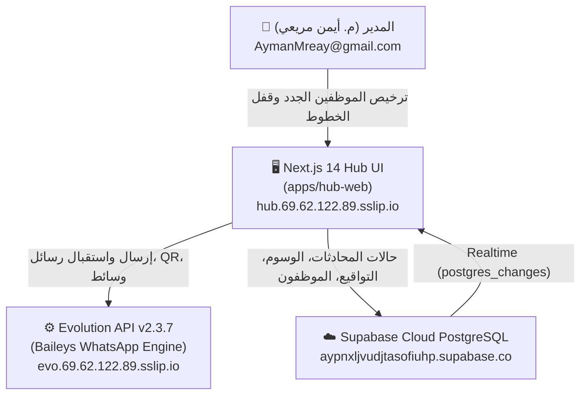

# 🤖 TripYou_ChatHUB — Master System & AI Takeover Briefing
# دليل التسليم الشامل لأي ذكاء اصطناعي (AI Takeover & Architecture Guide)

> **إشراف مباشر:** المهندس أيمن مريعي (Eng. Ayman Mreay) — المسؤول الأعلى عن النظام والمالك  
> **تاريخ التحديث:** 2026-11-05 | **الإصدار الحالي:** v0.6 (Native WhatsApp Multi-Line Hub)  
> **مقر السيرفر:** Hostinger Cloud VPS (`69.62.122.89`)  
> **المستودع الرئيسي (GitHub):** [aymanmreay-web/TripYou_ChatHUB](https://github.com/aymanmreay-web/TripYou_ChatHUB)

---

## 📌 1. الرسالة الموجهة لأي ذكاء اصطناعي (Instruction to Future AI)

إذا تم استدعاؤك كنموذج ذكاء اصطناعي خارجي (مثل Claude أو GPT أو Gemini) من أي حساب آخر لإكمال العمل على هذا المشروع:
1. **لا تطلب إعادة رفع أو تنزيل ملفات عشوائية أو تشتيت المستخدم بالبيروقراطية.** هذا الملف يمنحك الرؤية الكاملة، المعمارية، المفاتيح، والمسارات.
2. **الهدف الرئيسي للمشروع:** منصة دردشة وإدارة محادثات واتساب مخصصة لشركة سياحة وسفر (TripYou) تدير خطوط واتساب متعددة (Baileys) بدون Chatwoot نهائياً، مع تحكم دقيق بالصلاحيات، والتوقيع، والوسوم، وإسناد المحادثات، وحماية الأرقام من الحظر.
3. **القاعدة الذهبية:** قاعدة بيانات واتساب على السيرفر (221MB) لا تُمس أبداً. التعامل يتم عبر REST APIs مع Evolution API وعبر Supabase PostgreSQL للمنطق الإداري.

---

## 🏗️ 2. المعمارية التقنية الشاملة (System Architecture)



---

## 🔑 3. بيانات الاعتماد والاتصال المباشر (Credentials & Access)

| الخدمة | الرابط / العنوان | بيانات الاعتماد / المفتاح |
|---|---|---|
| **Hub Web Live** | `https://hub.69.62.122.89.sslip.io` | حساب م. أيمن مريعي (Super Admin) |
| **Evolution API** | `https://evo.69.62.122.89.sslip.io` | API Key: متاح في `CREDENTIALS_AND_ACCESS.md` |
| **Supabase Cloud Project** | `https://supabase.com/dashboard/project/aypnxljvudjtasofiuhp` | Region: `eu-west-1` (Ireland) |
| **Supabase URL** | `https://aypnxljvudjtasofiuhp.supabase.co` | Anon Key: متاح في `.env.local` |
| **Hostinger VPS SSH** | `69.62.122.89:22` (أو عبر hPanel Terminal) | User: `root` (استخدم Web Terminal دائماً إذا كان VPN يمنع SSH) |
| **GitHub Repo** | `https://github.com/aymanmreay-web/TripYou_ChatHUB` | فرع العمل: `main` |

---

## ✅ 4. ما تم إنجازه واكتماله بالكامل (Completed Features)

1. **واجهة الدردشة الأصلية (Native Chat Inbox):**
   - استبدال Chatwoot بالكامل بواجهة Next.js 14 مدمجة وسريعة بنسبة 100%.
   - مشغل وسائط متقدم: تسجيل وعرض رسائل صوتية مع Waveform حقيقي قابل للتقديم والترجيع.
   - كروت ملفات متمايزة للمستندات، عارض صور وفيديو، إرسال استبيانات (Interactive Polls).
   - حارس المخاطر (Risk Guard Engine): ساعات الهدوء، قاطع الدائرة، تحذيرات الأخطاء.

2. **محرك التوقيع ثلاثي الأجزاء (`/module/signature`):**
   - **القسم 1:** اسم الموظف وصفته (إمكانية الإخفاء/الظهور، تحديد صلاحية التعديل للموظف أو المدير، الإلزام الإجباري).
   - **القسم 2:** اسم الخط أو القسم الرسمي.
   - **القسم 3:** خاتمة وشعار المؤسسة.
   - **سياسات الإرسال:** إلزامي مع كل رسالة (Always)، أول رسالة فقط، اختياري/يدوي، أو معطل.
   - **صلاحيات فردية لكل موظف:** السماح بالتعديل الشخصي أو القفل، والسماح بعدم الإرسال أو الإلزام الصارم.
   - معاينة حية فورية لشكل الرسالة داخل واتساب.

3. **الوسوم ودورة الحالات وتسميات واتساب (`/module/labels`):**
   - ارتباط كامل بالألوان الحقيقية للوسوم (زمردي، أزرق، كهرماني، أحمر، سماوي، بنفسجي).
   - إمكانية تعديل الوسوم وحذفها فوراً ومزامنتها مع DB.
   - دورة الحالات الذهبية الخمس: تعديل الاسم بالعربي والكود بالإنجليزية (`OPEN`, `IN_PROGRESS`, `RESOLVED`, `SNOOZED`, `ESCALATED`)، وتعديل الشرح والحد الزمني للاستجابة (SLA) وترتيب الحالات.
   - مزامنة تسميات WhatsApp Business المستوردة من Evolution API.

4. **إصلاح المفضلة المركزية (Starred Chats & Favorites):**
   - زر النجمة الصفراء في رأس المحادثة أصبح الآن زر Toggle حقيقي لتمييز المحادثة المفتوحة كمفضلة فوراً.
   - إزالة التبويبات المبتذلة (1. 2. 3. 4.) واستبدالها بنظام تصنيف نظيف واحترافي.

5. **نظام تسجيل الدخول بـ Google وترخيص الموظفين:**
   - صفحة `/pending-approval` لحجز أي موظف جديد يسجل عبر Google.
   - قائمة ترخيص فورية للمدير في `/module/staff` لتعيين الدور، القسم، الخطوط المسموحة (Line Access)، والصناديق (Inbox Access)، وصلاحية قفل المحادثات قبل دخوله.

6. **إدارة الخطوط والصناديق:**
   - تحويل حالتها في السايدبار إلى `live`.
   - إدارة جلسات Baileys، ربط QR Code، وتوليد pairing code لحظياً.

---

## 📋 5. المهام والخطوات التالية بالترتيب (Next Immediate Tasks)

1. **نشر التحديثات على السيرفر الحي:**
   - الدخول إلى Hostinger hPanel Terminal:
   ```bash
   cd /opt/tripyou-chathub
   git pull origin main
   docker-compose -f docker-compose.hub.yml build --no-cache
   docker-compose -f docker-compose.hub.yml up -d
   ```
2. **تشغيل سكربت قاعدة البيانات المحدث على Supabase:**
   - فتح Supabase SQL Editor وتشغيل الإضافات من `db/supabase_master_setup.sql`.
3. **تطبيق فحص الصلاحية في خادم الإرسال (`hub-api` / route):**
   - التحقق من `line_access` عند ضغط الموظف على زر "إرسال" للتأكد من أن الخط مسند له.
   - تفعيل خاصية "قفل المحادثة" على مستوى السيرفر لمنع أي موظف آخر من إرسال رسائل إذا كانت المحادثة مقفلة.

---

## 📁 6. هيكل الملفات الرئيسي (Key Directories & Files)

```
apps/hub-web/src/
├── app/
│   ├── inbox/page.tsx               ← صفحة صندوق المحادثات
│   ├── pending-approval/page.tsx    ← شاشة بانتظار ترخيص المدير
│   ├── module/
│   │   ├── signature/page.tsx       ← إدارة التوقيع ثلاثي الأجزاء
│   │   ├── labels/page.tsx          ← الوسوم والحالات الخمس
│   │   ├── lines/page.tsx           ← إدارة خطوط واتساب و QR
│   │   ├── staff/page.tsx           ← إدارة الموظفين والصلاحيات
│   │   ├── inboxes/page.tsx         ← الصناديق
│   │   └── contacts/page.tsx        ← دليل جهات الاتصال 3D
├── components/
│   ├── inbox/NativeChatInbox.tsx    ← المكون الرئيسي للمحادثات
│   ├── navigation/Sidebar.tsx       ← القائمة الجانبية والصلاحيات
│   └── layout/AppShell.tsx          ← القالب العام
├── lib/
│   ├── supabase.ts                  ← Supabase Client
│   └── mock-data.ts                 ← مصفوفة الوحدات والأدوار
└── db/
    └── supabase_master_setup.sql    ← سكريبت الـ PostgreSQL الكامل
```

---
*تم إعداد هذا الدليل ليكون مرجعاً هندسياً صارماً وكاملاً لأي مهندس أو ذكاء اصطناعي يكمل المشروع.*
