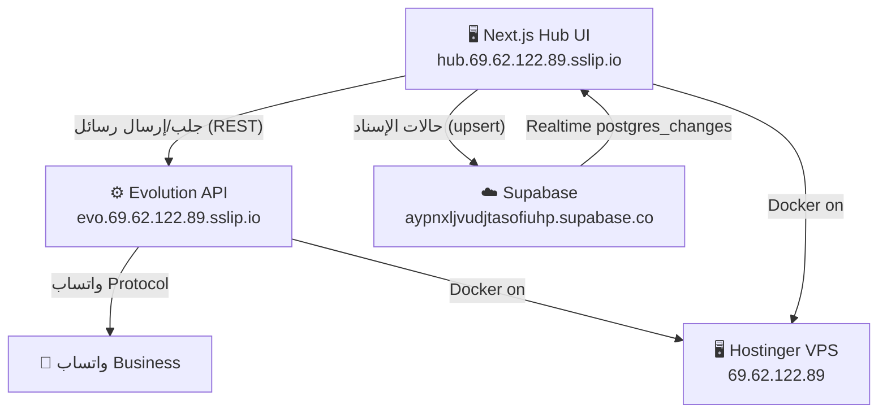

# TripYou_ChatHUB — ملف التقدم والخطة التنفيذية الشاملة
> **إشراف:** م. أيمن مريعي — By Eng. Ayman Mreay  
> **تاريخ التحديث:** 2026-11-04  
> **حالة السيرفر:** حي ويعمل (Hostinger VPS `69.62.122.89`)  
> **المستودع الرسمي:** [aymanmreay-web/TripYou_ChatHUB](https://github.com/aymanmreay-web/TripYou_ChatHUB)  
> **ملف بيانات الاعتماد والمفاتيح:** [`CREDENTIALS_AND_ACCESS.md`](../CREDENTIALS_AND_ACCESS.md)  
> **ملف تهيئة سوبابيز الشامل:** [`db/supabase_master_setup.sql`](../db/supabase_master_setup.sql)

---

## ✅ المرحلة الأولى: مكتملة 100%

### 1. الفصل المعماري الآمن (Architectural Decoupling)
| الطبقة | الحل | الحالة |
|---|---|---|
| **واتساب (المحادثات الحية)** | Evolution API على السيرفر مباشرةً | ✅ يعمل |
| **منطق الموظفين والإسناد** | Supabase Cloud PostgreSQL | ✅ منشأ ومفحوص |
| **قاعدة واتساب (221MB)** | لا يتم لمسها أو نقلها مطلقاً | ✅ محمية |

### 2. حارس المخاطر (Risk Guard Engine) — مطبق في `NativeChatInbox.tsx`
| الميزة | التفصيل | الحالة |
|---|---|---|
| **ساعات الهدوء** | 01:00-07:00 KSA — نافذة تأكيد منبثقة | ✅ مفعّل |
| **قاطع الدائرة** | 3 أخطاء متتالية → إيقاف + شريط إنذار أحمر + زر إعادة ضبط | ✅ مفعّل |
| **قفل خط الإرسال** | قفل بعد أول إرسال ناجح منعاً للتشتت | ✅ مفعّل |
| **شارة تسخين الأرقام** | 50 رسالة/يوم للأرقام الجديدة | ✅ مفعّل |

### 3. دورة الإسناد والعدادات (Assignment Cycle & SLA Timers)
| الميزة | التفصيل | الحالة |
|---|---|---|
| **الحالات الخمس** | open / in_progress / resolved / snoozed / escalated | ✅ مفعّل |
| **إسناد الموظفين** | قائمة منسدلة: م. أيمن، سارة، محمد، عام | ✅ مفعّل |
| **عداد SLA** | أخضر <5د / أصفر 5-10د / أحمر نابض 10د+ | ✅ مفعّل |
| **تبويبات الفلترة** | الكل / لي / غير مقروء / مصعدة / مجموعات | ✅ مفعّل |
| **الأزرار السريعة** | "تم الحل" / "تصعيد" / "إعادة الفتح" | ✅ مفعّل |

### 4. Supabase Realtime Integration & إدارة الوسوم والحالات — **مكتمل ومُحدث ✨**
| الميزة | التفصيل | الحالة |
|---|---|---|
| **حفظ الحالات في Supabase** | `upsertConversationState()` عند كل تغيير حالة أو إسناد | ✅ مطبق |
| **مزامنة Realtime** | `postgres_changes` → `conversations` → تحديث UI فوري | ✅ مطبق |
| **لوحة إدارة الوسوم والتصنيفات** | صفحة `/module/labels` لإدارة وسوم النظام، والحالات الخمس، وتسميات واتساب بزنس | ✅ مطبق وحي |
| **ترقية الحاوية** | الترقية إلى Node 22-alpine لمنع أي تحذيرات توافقية مع `@supabase/supabase-js` | ✅ منشور على السيرفر |
| **Import Supabase Client** | `supabase` client مستورد من `lib/supabase.ts` | ✅ |

### 5. قاعدة بيانات Supabase — منشأة ومفحوصة 100%
- **الملف الموحد:** `db/supabase_master_setup.sql`
- **المنطقة:** `eu-west-1` (Ireland)
- **14 جدولاً:** departments, permissions, roles, role_permissions, work_schedules, lines, line_circuit_breakers, staff, contacts, groups, conversations, messages, risk_events, audit_logs
- **Views على public schema** للتوافق مع Supabase Table Editor
- **Realtime مفعّل** على: `public.conversations`, `public.messages`, `public.lines`
- **بيانات مزروعة:** 4 أقسام، 4 أدوار، خط Master، حساب م. أيمن مريعي
- **فحص REST API ✅** — يرجع بيانات الموظف الصحيحة

### 6. البنية التقنية الشاملة
```
apps/hub-web/src/
├── components/inbox/NativeChatInbox.tsx  ← الواجهة الرئيسية (حارس + إسناد + Realtime)
├── lib/supabase.ts                        ← Supabase client (anon + admin)
└── types/index.ts                         ← ConversationStatus + ConversationItem
```

---

## 🔄 المرحلة الثانية: النشر على السيرفر (جارٍ)

### الوضع الحالي
| العنصر | الحالة |
|---|---|
| **GitHub main branch** | محدث حتى `c7e9c7e` + ما بعده (Realtime) |
| **السيرفر** | يشغّل الإصدار `95588d6` (قديم) |
| **VPN** | UrbanVPN يمنع SSH المباشر |

### طريقة النشر (عبر Hostinger hPanel Terminal)
1. افتح https://hpanel.hostinger.com → VPS `1507912` → **Terminal**
2. نفّذ:
```bash
cd /opt/tripyou-chathub
git pull origin main
docker-compose -f docker-compose.hub.yml build --no-cache
docker-compose -f docker-compose.hub.yml up -d
docker logs tripyou-chathub-web --tail=50
```
3. تحقق من: https://hub.69.62.122.89.sslip.io

> **ملاحظة مهمة:** `docker-compose.hub.yml` يمرر متغيرات Supabase كـ `environment` للحاوية — لا حاجة لنسخ `.env.local` داخل Docker image.

### بعد النشر: إيقاف Chatwoot لتوفير الرام
```bash
docker stop chatwoot-rails-1 chatwoot-sidekiq-1 chatwoot-postgres-1 chatwoot-redis-1
docker rm chatwoot-rails-1 chatwoot-sidekiq-1 chatwoot-postgres-1 chatwoot-redis-1
```
> يوفر **~1.1 GB RAM** إضافي للسيرفر

---

## 📋 الخطوات القادمة (بعد النشر)

| الأولوية | المهمة | الوصف |
|---|---|---|
| 🔴 عالية | **نشر GitHub→VPS** | `git pull + docker build + up` عبر hPanel Terminal |
| 🔴 عالية | **تشغيل SQL على Supabase** | لصق `supabase_master_setup.sql` في SQL Editor → Run |
| 🟠 متوسطة | **إيقاف Chatwoot** | توفير ~1.1GB RAM بعد التأكد من عمل Hub |
| 🟡 عادية | **صفحة إدارة الموظفين** | CRUD على `staff` table عبر `/module/staff` |
| 🟡 عادية | **تحديث حالات المحادثات من Supabase** | جلب الحالات المحفوظة عند تحميل chats |
| 🟢 مستقبلية | **الإشعارات الفورية (Push Notifications)** | عبر Supabase Realtime + Service Worker |
| 🟢 مستقبلية | **بوابة اشتراك العملاء** | صفحة تسجيل دخول بالوكالة أو اختصار القسم |

---

## 🔧 تاريخ المشكلات والحلول

| الخطأ | السبب | الحل |
|---|---|---|
| `PGRST106: Invalid schema: hub` | Supabase يعرض public وgraphql_public فقط | أُنشئت views على public schema |
| `getaddrinfo ENOTFOUND db.aypnxljvudjtasofiuhp.supabase.co` | الجهاز لا يدعم IPv6 | التحويل لـ Connection Pooler (IPv4) |
| `SSH Connection timed out` إلى `69.62.122.89` | UrbanVPN يوجه كل الترافيك | استخدام Hostinger hPanel Terminal |
| `Infinite re-render loop` في Inbox | useEffect dependency loop | إصلاح dependencies وتحويل لـ useCallback |
| `MODULE_NOT_FOUND: pg` | تشغيل script من مكان خاطئ | تشغيل من داخل `apps/hub-web/` |

---

## 🏗️ المعمارية التقنية الكاملة



**القاعدة الذهبية:** واتساب (221MB) ← يبقى على السيرفر مع Evolution — لا يُلمس أبداً.

---

## 🔑 المفاتيح والروابط السريعة

| الخدمة | الرابط |
|---|---|
| Hub URL | https://hub.69.62.122.89.sslip.io |
| Evolution API | https://evo.69.62.122.89.sslip.io |
| Supabase Dashboard | https://supabase.com/dashboard/project/aypnxljvudjtasofiuhp |
| GitHub | https://github.com/aymanmreay-web/TripYou_ChatHUB |
| hPanel VPS | https://hpanel.hostinger.com |

> **الملف الكامل للمفاتيح والباسووردات:** [`CREDENTIALS_AND_ACCESS.md`](../CREDENTIALS_AND_ACCESS.md)
