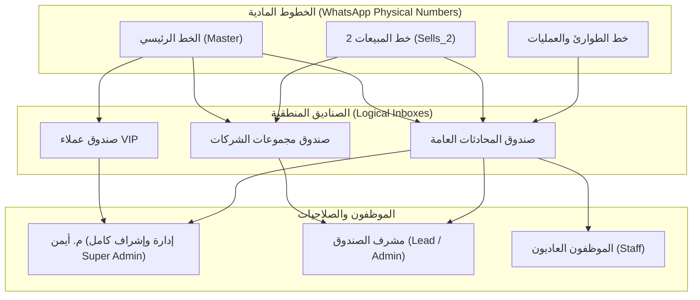
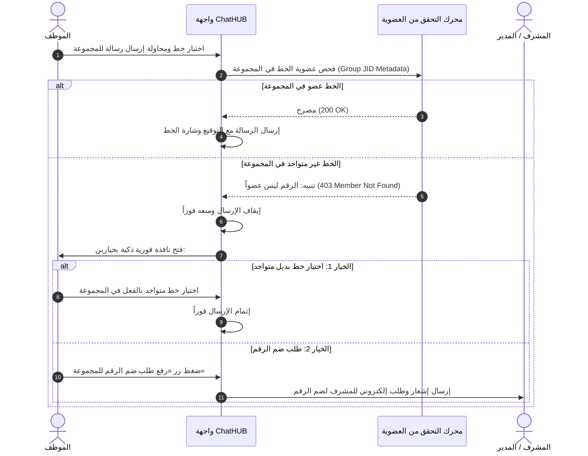

<div dir="rtl" class="text-right" style="direction: rtl; text-align: right; font-family: sans-serif; line-height: 1.8;">

# الدليل المعماري الشامل: منطق الصناديق والخطوط وصلاحيات نظام «المحادثات السريعة» — <bdi dir="ltr">TripYou ChatHUB</bdi>

---

## 💡 1. الفلسفة الأساسية: الفرق الجوهري بين "الخط" و"الصندوق"

الخلط الشائع في أنظمة المحادثات يحدث عندما يتم التعامل مع رقم الهاتف كأنه هو مساحة العمل. في **<bdi dir="ltr">TripYou ChatHUB</bdi>**، قمنا بالفصل التام بين المفهومين وفق المعادلة التالية:

> [!IMPORTANT]
> - **الخط (<bdi dir="ltr">Line / Channel</bdi>):** هو **قناة اتصال مادية** (رقم شريحة واتساب فعلية، مثل: <bdi dir="ltr">+966554125782</bdi>). وظيفته تقنية بحتة: استقبال الرسائل وإرسالها عبر السيرفر.
> - **الصندوق (<bdi dir="ltr">Inbox / Workspace</bdi>):** هو **مساحة عمل منطقية وتوزيع وظيفي** (مثل: صندوق حجوزات VIP، صندوق المجموعات، صندوق الشكاوى والدعم). وظيفته تنظيمية وإدارية: يحدد من يرى المحادثة وما هي سياسة التعامل معها.

---

## 🏗️ 2. كيف ترتبط الخطوط بالصناديق؟ (علاقة متعدد لمتعدد <bdi dir="ltr">Many-to-Many</bdi>)

المنظومة مصممة بمرونة فائقة تسمح بالسيناريوهات التالية:

1. **صندوق يضم أكثر من خط:**
   - مثال: **صندوق المبيعات** مرتبط بـ (خط المبيعات 1 + خط المبيعات 2 + الخط الرئيسي).
   - **الفائدة:** يرى موظف المبيعات كافة استفسارات العملاء الواردة على أي من هذه الأرقام في شاشة واحدة دون الحاجة للتنقل بين حسابات مختلفة.
2. **خط واحد مشترك في أكثر من صندوق:**
   - مثال: **الخط الرئيسي (<bdi dir="ltr">Master</bdi>)** يستقبل رسائل عامة، رسائل حجوزات، ورسائل من عملاء مهمين.
   - **الفائدة:** يمكن ربط هذا الخط بصندوق "العمليات العامة" وصندوق "كبار العملاء" في نفس الوقت.



---

## 📥 3. نظام الصناديق للاستقبال (<bdi dir="ltr">Inbound Box Scope</bdi>) وتوحيد المجموعات

1. **محدد نطاق الصناديق (<bdi dir="ltr">Inbox Filter Scope</bdi>):**
   - تم ربط محدد الصناديق في أعلى القائمة الجانبية (جميع الصناديق المتاحة أو الصناديق المخصصة للمستخدم).
   - الصندوق يستقبل تلقائياً كل المحادثات الواردة على كافة الخطوط المرتبطة به.
2. **منع التكرار ودمج المجموعات المشتركة (<bdi dir="ltr">Group Deduplication</bdi>):**
   - إذا كانت مجموعة واتساب (مثل <bdi dir="ltr">test 5</bdi> أو "مجموعة وكلاء مصر") ينتمي إليها أكثر من خط مادي (مثل <bdi dir="ltr">Master</bdi> و <bdi dir="ltr">Sells_2</bdi>):
   - **تظهر كمحادثة موحدة واحدة فقط** في قائمة الصندوق وتُخفى المحادثات المنفصلة المكررة لكل خط.
   - تُعرض **شارة تفاعلية واضحة** توضح أسماء وأرقام الخطوط المشتركة داخل هذه المجموعة لتنبيه الموظف.

---

## 🔒 4. محرك الرؤية وحماية محتوى المحادثات (<bdi dir="ltr">Access & Visibility Engine</bdi>)

تم تحديث وضبط درجات الوصول الصارمة إلى محتوى الرسائل وفق المستويات التالية:

```mermaid
flowchart TD
    RoleCheck{"ما هو دور المستخدم؟"}
    
    RoleCheck -->|Super Admin\nالمدير الأعلى| AccessFull["صلاحية كاملة ومطلقة\nقراءة، كتابة، إشراف، تدقيق في كل الصناديق"]
    
    RoleCheck -->|Lead / Admin\nمشرف الصندوق| AccessLead["رؤية كاملة للصندوق\nقراءة محتوى كافة الرسائل لجميع المحادثات التابعة للصندوق"]
    
    RoleCheck -->|Staff\nالموظف العادي| AssignCheck{"هل المحادثة مسندة له؟"}
    
    AssignCheck -->|نعم (Assigned to Me)| AccessStaffMe["قراءة المحتوى كاملة\nوالرد وإرسال الوسائط وإغلاق التذكرة"]
    
    AssignCheck -->|لا (غير مسندة أو لزميل)| AccessLocked["🔒 حجب محتوى الرسائل بالكامل\nظهور شاشة أمان برمز القفل مع:\n1. زر طلب إسناد المحادثة لي\n2. زر طلب إذن قراءة"]
```

### قواعد المستويات الثلاثة:
1. **المدير الأعلى (<bdi dir="ltr">Super Admin</bdi>):**
   - يرى ويقرأ ويرسل في كل شيء دون أي قيود برمجية أو إدارية.
2. **مشرف الصندوق (<bdi dir="ltr">Lead / Box Admin</bdi>):**
   - يرى كامل محتوى ورسائل كافة المحادثات التابعة لصندوقه لغايات المتابعة وتوزيع المهام ومراقبة الجودة.
3. **الموظف العادي (<bdi dir="ltr">Regular Staff</bdi>):**
   - **لا يمكنه فتح وقراءة محتوى الرسائل إلا للمحادثات المسندة إليه فقط.**
   - إذا حاول فتح أي محادثة غير مسندة إليه (سواء كانت شاغرة جديدة أو مسندة لزميل آخر)، تظهر له فوراً **شاشة أمان محكمة برمز القفل (<bdi dir="ltr">Security Gate Modal</bdi>)** تتضمن:
     - زر مباشر لـ **«طلب إسناد المحادثة لي»** (أو اقتناص إذا كانت غير مسندة).
     - زر مباشر لـ **«طلب إذن قراءة»** مع تسجيل مبرر الطلب في سجل التدقيق (<bdi dir="ltr">Audit Log</bdi>).

---

## ✍️ 5. خطوط الإرسال التابعة للمستخدم والتوقيع الموحد الذكي

1. **شريط اختيار الخط السريع (<bdi dir="ltr">Outbound Line Switcher</bdi>):**
   - الموظف يمكنه الإرسال فقط عبر الخطوط المرتبطة به والمصرح له بها شخصياً.
   - تظهر له أزرار تبديل سريعة أعلى حقل الإدخال مباشرة:  
     `الإرسال عبر: [ الخط الرئيسي ] [ المبيعات 2 ]`
2. **توحيد المظهر الصادر (<bdi dir="ltr">Unified Outbound Bubble</bdi>):**
   - إذا أرسل الموظف إلى نفس المجموعة من خطين مختلفين، تظهر جميع الرسائل الصادرة في نفس جهة الإرسال (جهة الصادر).
   - يتم تمييز كل رسالة تلقائياً بـ:
     - **شارة الموظف الصريح** واسم الخط المرسل منه.
     - **التوقيع الذكي المخصص** للخط المختار وفق سياسة التوقيع الثلاثية المعتمدة.

---

## ⚠️ 6. معالجة حالات الرد من رقم غير متواجد في المجموعة

عندما يحاول الموظف اختيار خط أو الإرسال إلى مجموعة من رقم شريحة ليس عضواً فيها:



---

## 🏢 7. مثال واقعي شامل من بيئة العمل

1. **استقبال استفسار أو تفاعل في مجموعة:**
   - مجموعة «وكلاء العمرة 2026» تضم رقمين للشركة: <bdi dir="ltr">Master</bdi> ورقم <bdi dir="ltr">Sells_2</bdi>.
   - تظهر للموظفين كمحادثة واحدة موحدة باسم المجموعة وتحمل شارة (خطين مشتركين).
2. **صلاحية الفتح:**
   - الموظف (سالم) يرى المجموعة في القائمة لأن الصندوق مخصص له، ولكن لأنها لم تُسند له بعد، لا يستطيع قراءة الرسائل ويظهر له القفل مع زر «طلب إسناد المحادثة لي».
   - المشرف (رئيس القسم) يستطيع فتحها مباشرة ومطالعة ما كُتب.
3. **بعد الإسناد والإرسال:**
   - يسند المشرف المحادثة لـ (سالم). يفتحها سالم ويختار من الشريط العلوي `الإرسال عبر: [المبيعات 2]`.
   - تخرج الرسالة باسم خط المبيعات وبتوقيع سالم الرسمي وتظهر في جهة الصادر.
   - إذا حاول سالم التبديل إلى خط ثالث غير مشارك في المجموعة، يمنعه النظام فوراً ويطالبه باختيار خط مشارك أو رفع طلب إضافة إلكتروني للإدارة.

---

## 🛡️ 8. ملخص المقارنة بين النموذج السابق والنموذج المحدث

| المعيار | النظام السابق | النموذج المحدث (المحادثات السريعة) |
| :--- | :--- | :--- |
| **قراءة الرسائل للموظف** | كان بإمكانه قراءة غير المسندة ثم اقتناصها. | **حجب تام لمحتوى أي محادثة غير مسندة** للموظف برمز قفل وشاشة طلب إسناد/إذن. |
| **صلاحية المشرف (<bdi dir="ltr">Lead</bdi>)** | غير مفصلة بوضوح بين الموظف والمدير. | **رؤية وقراءة كاملة** لكافة محادثات ورسائل الصندوق دون حجب. |
| **المجموعات متعددة الخطوط** | تظهر كمحادثات متعددة لكل رقم. | **دمج تام في محادثة موحدة واحدة** مع شارة توضح الخطوط المشتركة. |
| **التحقق من عضوية المجموعة** | قد يُرسل الخط ويحدث خطأ من واتساب. | **كشف مسبق وفوري** يمنع الإرسال ويعرض خيار التبديل أو طلب ضم الرقم. |
| **شريط الإرسال الصادر** | قائمة منسدلة بسيطة بجانب الإرسال. | **شريط أزرار سريع أعلى حقل الإدخال** مع توقيع ذكي موحد ومطابق لجهة الصادر. |

</div>
